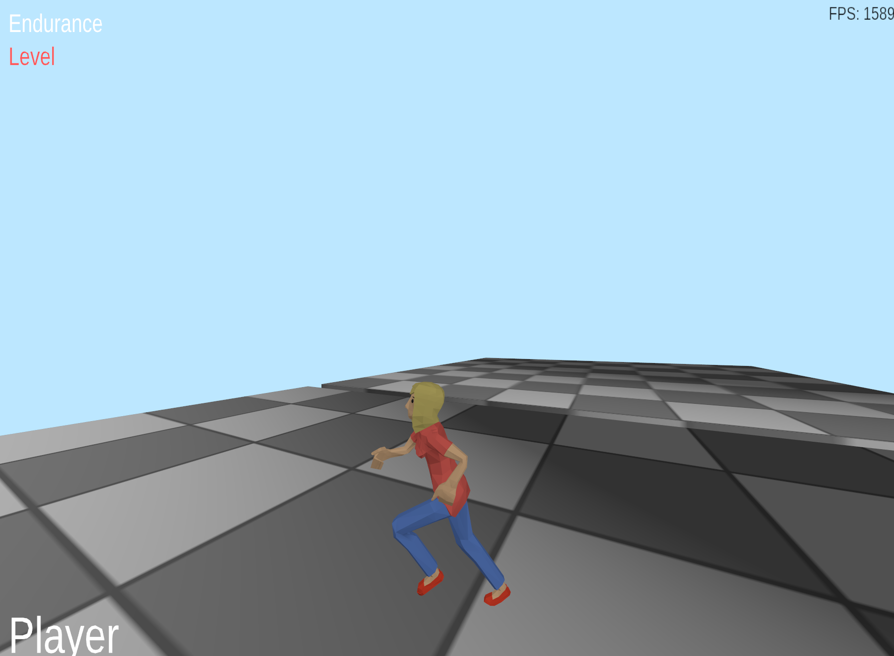

# Vulkan Engine


A personal real-time rendering engine written in modern C++ (C++20) on top of the Vulkan API.



*Skeletal animation, physics-driven character controller and an RmlUi-based UI overlay.*

## Features

- **Vulkan core layer** (`vulkan_struct`) — RAII wrappers for Vulkan objects built on a single
  `CVulkanObject<Handle, Device, CreateInfo>` template, create-info builders, function loading via volk
- **Rendering**
  - Dynamic rendering (`VK_KHR_dynamic_rendering`) and Synchronization2 barriers
  - Multiple frames in flight, swapchain recreation on resize
  - Static and skinned meshes
- **Compute** — GPU ray picking for object selection
- **Skeletal animation** — loading and playback of animated models (assimp)
- **Text rendering** — FreeType glyph outlines vectorised and triangulated into meshes
- **2D UI layer** and in-engine menu
- **Scene / component system**, orbit camera, physics-driven character controller, selection and highlighting
- **Multiple front-ends** — GLFW and SDL applications share the same engine library; an optional Qt 6
  front-end is also available (see [Building](#building))

## Project structure

| Module | Description |
|---|---|
| `vulkan_struct` | Low-level Vulkan wrappers and struct builders |
| `vulkan_engine` | Render system, pipelines, descriptors, compute, animation, scene |
| `asset_loader` | Model and scene description loading (YAML) |
| `text` | Glyph vectorisation and triangulation |
| `physic_engine` | Simple physics |
| `interface_menu` | 2D UI / menu |
| `commons` | Shared types, geometry primitives, logging |
| `shaders` | GLSL shaders, compiled to SPIR-V at build time |
| `window_app` / `sdl_app` | GLFW / SDL applications |
| `qt_gui_render` | Qt 6 application (optional, off by default) |

## Building

Requirements:

- CMake 3.26+ (CMake 4.x is supported)
- C++20 compiler (tested with MSVC / Visual Studio)
- [Vulkan SDK](https://vulkan.lunarg.com/) 1.4 (`glslangValidator` is used to compile shaders)
- *Optional:* Qt 6 (Core, Widgets) for the `qt_gui_render` application

Other dependencies (volk, VMA, GLFW, SDL, assimp, FreeType, RmlUi, Bullet, stb, glm, yaml-cpp) are downloaded
automatically with CMake `FetchContent`.

```bash
cmake -S src -B build
cmake --build build --config Release
```

Executables and compiled shaders are placed in `build/bin`.

The Qt front-end is disabled by default. To build it, enable the option and point CMake to your Qt
installation:

```bash
cmake -S src -B build -DBUILD_QT_APP=ON -DCMAKE_PREFIX_PATH=C:/Qt/6.8.0/msvc2022_64
```

## Running

The demo assets (model, textures, fonts, UI and scene description `config_saved.yaml`) are stored in
`src/resource/models` and are copied to `build/bin/models` automatically when an application is built.

Start one of the applications from `build/bin`: `window_app` (GLFW) or `sdl_app` (SDL)
(or `qt_gui_render` if it was built with `BUILD_QT_APP=ON`).

## Controls

| Key | Action |
|---|---|
| W / A / S / D | Move the character |
| Space | Jump |
| Left mouse | Select object |
| Ctrl + left mouse | Add to selection |
| Esc | Exit (GLFW app) |

## Third-party code

This repository includes code derived from the following projects; the original copyright notices
are kept in the corresponding files and the full license texts are in [`third_party_licenses/`](third_party_licenses/):

- **[Poly2Tri](https://github.com/jhasse/poly2tri)** — constrained Delaunay triangulation
  (`text/tg_sweep*`, `text/tg_shapes*`, `text/tg_utils.h`), BSD 3-Clause
- **[FTGL](https://github.com/frankheckenbach/ftgl)** — glyph outline vectoriser
  (`text/tg_vectoriser*`), MIT
- **[NVIDIA nvpro-samples](https://github.com/nvpro-samples)** — PBR, random and ray tracing shader
  helpers (`shaders/common/`, `shaders/Ray2/pbr_gltf.glsl`), Apache 2.0
- **[LearnOpenGL](https://learnopengl.com/Guest-Articles/2020/Skeletal-Animation)** — skeletal animation
  (`vulkan_engine/en_animation_*`, `shaders/anim_model.vert`),
  [CC BY-NC 4.0](https://creativecommons.org/licenses/by-nc/4.0/) — **non-commercial use only**

Assets:

- **[Liberation Sans](https://github.com/liberationfonts/liberation-fonts)** 2.1.5 — UI and 3D text font
  (`resource/models/fonts/LiberationSans-*.ttf`), SIL Open Font License 1.1
- **[Animated Woman](https://poly.pizza/m/9kF7eTDbhO)** by [Quaternius](https://quaternius.com)
  (`resource/models/assets/woman/`), CC0

Libraries fetched at build time are distributed under their own licenses.

## License

The engine code is licensed under the [MIT License](LICENSE), except for the third-party files listed
above, which remain under their original licenses.
